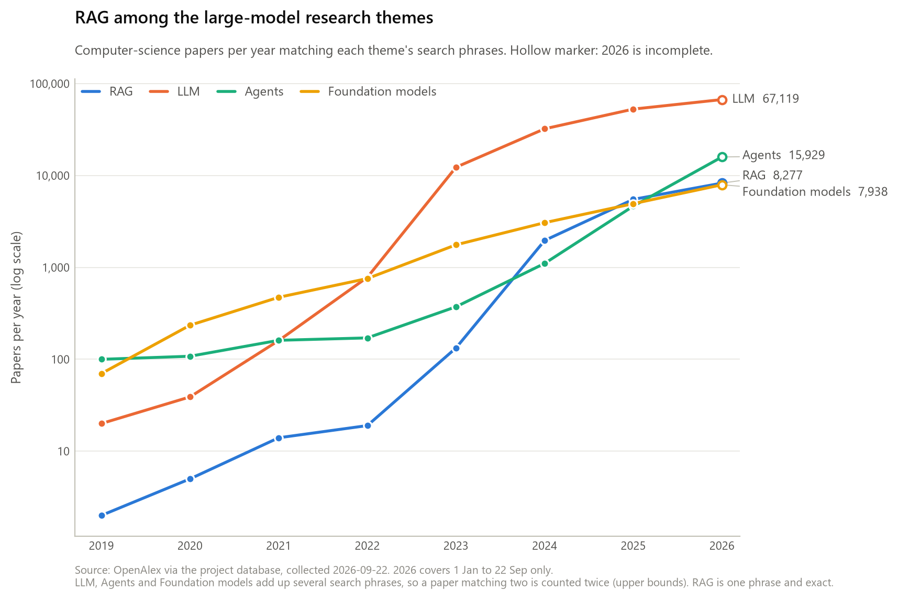
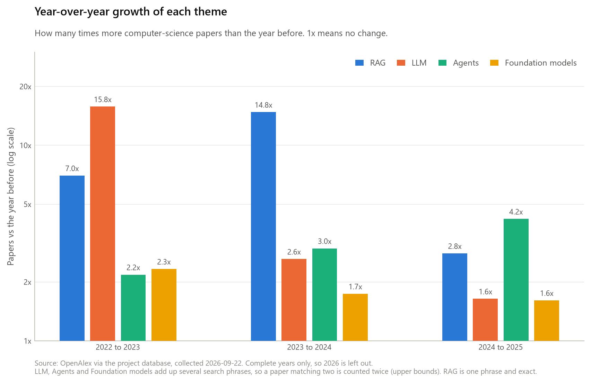
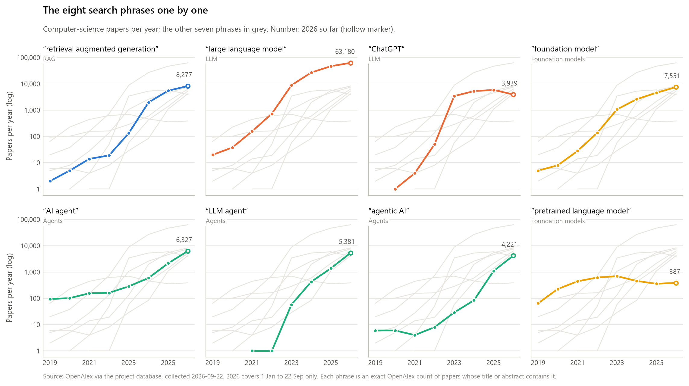
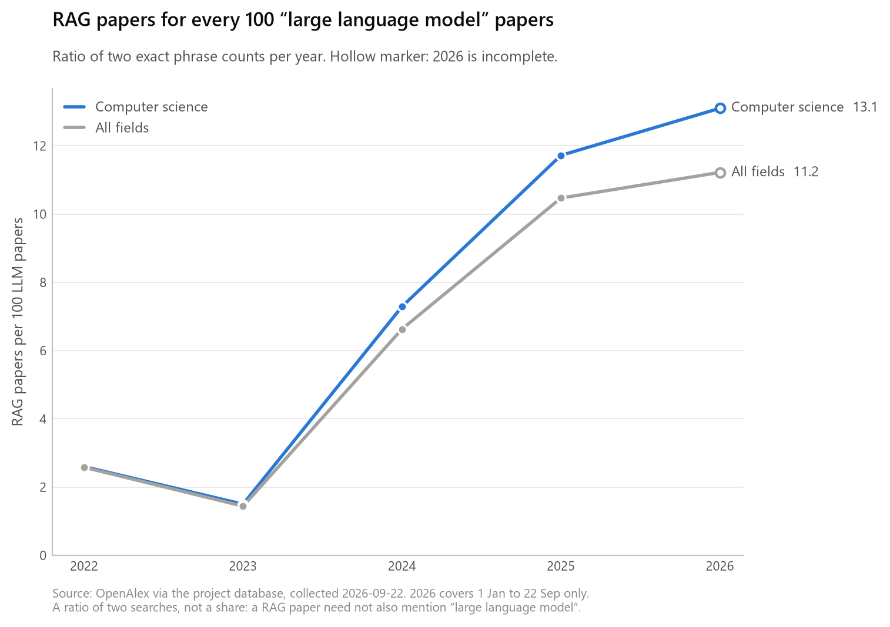

# 方向一：RAG 与其他大模型主题的对比

把 RAG 放回大模型研究的整体里看：它和 LLM、Agents、Foundation Models 相比有多大、什么时候起飞、增长有多快。

```bash
uv run python analysis/01_theme_comparison/make_figures.py
```

数据全部来自 `meta.recall_probes`：采集时向 OpenAlex 询问了 8 个检索短语的逐年论文数。
**只有 RAG 的论文被下载进了数据库，其余三个主题只有计数，没有论文本身。**

| 主题 | 检索短语 |
|---|---|
| RAG | retrieval augmented generation |
| LLM | large language model、ChatGPT |
| Agents | AI agent、LLM agent、agentic AI |
| Foundation models | foundation model、pretrained language model |

---

## 先看这三个数据坑

1. **RAG 在旧文件里被算了两遍。** RAG 短语被探查了两次，直接 `sum` 会翻倍。
   Release 里的 `theme_year_counts.csv` 和 `data-overview.html` 的第一张图都带着这个错
   （2026 年写成 16,554，实际 8,277）。本目录的 SQL 只取每个短语最近一次探查，数字是对的。
2. **LLM、Agents、Foundation models 是上限。** 一个主题由几个短语相加，同时命中两个短语的论文会被算两次，
   而且无法去重（没有论文明细）。RAG 只有一个短语，是精确值。想要精确数就用图 3 的单个短语。
3. **2026 年只到 9 月 22 日。** 图里用空心点标出。

---

## 图 1　四个主题的逐年论文数



| | |
|---|---|
| SQL | [`sql/fig1_theme_yearly.sql`](sql/fig1_theme_yearly.sql) |
| CSV | [`output/fig1_theme_yearly.csv`](output/fig1_theme_yearly.csv) |
| 列 | `theme` 主题；`year`；`works_cs` 计算机领域论文数（图上画的）；`works_all` 全领域论文数；`phrases` 该主题由几个短语相加 |

图上能读出的：

- 2026 年（至 9/22）：LLM 67,119，Agents 15,929，RAG 8,277，Foundation models 7,938。
- RAG 从 2023 年的 133 篇到 2024 年的 1,966 篇。
- 2025 年 RAG（5,505）还高于 Agents（4,647），2026 年 Agents 反超。注意 Agents 是三个短语之和。

想改：换成全领域就把脚本里的 `works_cs` 改成 `works_all`；纵轴是对数轴，去掉 `ax.set_yscale("log")` 即为线性。

## 图 2　逐年增长倍数



| | |
|---|---|
| SQL | [`sql/fig2_growth_multiple.sql`](sql/fig2_growth_multiple.sql)（用了窗口函数 `lag`） |
| CSV | [`output/fig2_growth_multiple.csv`](output/fig2_growth_multiple.csv) |
| 列 | `works` 当年论文数；`works_previous_year` 上一年；`growth_multiple` 两者之比 |

图上能读出的：

- 增长最猛的一年各不相同：LLM 是 2023 年（15.8 倍），RAG 是 2024 年（14.8 倍），Agents 是 2025 年（4.2 倍）。
- 2025 年 RAG 仍有 2.8 倍，LLM 和 Foundation models 都降到 1.6 倍。

只比较完整年份，所以没有 2026。CSV 里还有 2022 年的行，图上没画。

## 图 3　八个检索短语分别的走势



| | |
|---|---|
| SQL | [`sql/fig3_phrase_yearly.sql`](sql/fig3_phrase_yearly.sql) |
| CSV | [`output/fig3_phrase_yearly.csv`](output/fig3_phrase_yearly.csv) |
| 列 | `query_key` 短语的内部编号；`phrase` 短语原文；`works_cs` / `works_all` 同图 1 |

每个数都是 OpenAlex 的精确计数，没有重复计算的问题。图上能读出的：

- "ChatGPT" 在 2025 年见顶（5,890），2026 年至今 3,939。
- "pretrained language model" 在 2023 年见顶（698），之后回落。
- "agentic AI" 从 2024 年的 84 篇到 2025 年的 1,101 篇，2026 年至今 4,221 篇。

## 图 4　每 100 篇 LLM 论文对应多少篇 RAG 论文



| | |
|---|---|
| SQL | [`sql/fig4_rag_per_100_llm.sql`](sql/fig4_rag_per_100_llm.sql) |
| CSV | [`output/fig4_rag_per_100_llm.csv`](output/fig4_rag_per_100_llm.csv) |
| 列 | `field_scope` `cs` 或 `all`；`rag_works`、`llm_works` 两个短语各自的论文数；`rag_per_100_llm` |

图上能读出的：计算机领域从 2023 年的 1.5 升到 2025 年的 11.7，2026 年至今 13.1。

这是**两个检索结果的比值，不是占比**：RAG 论文不一定同时出现 "large language model" 这个词。
分母只用了 "large language model" 一个短语，没有加 ChatGPT。
