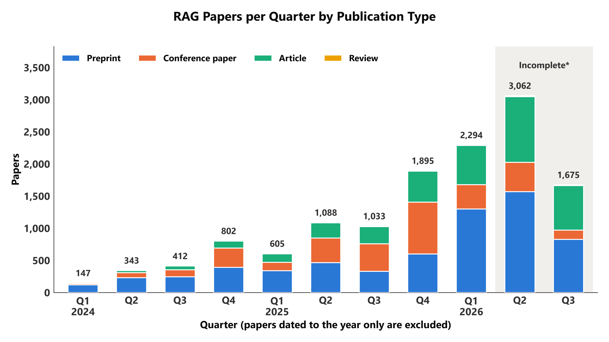
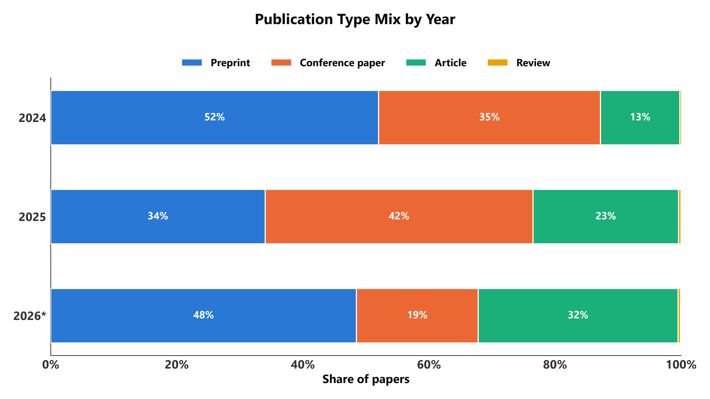
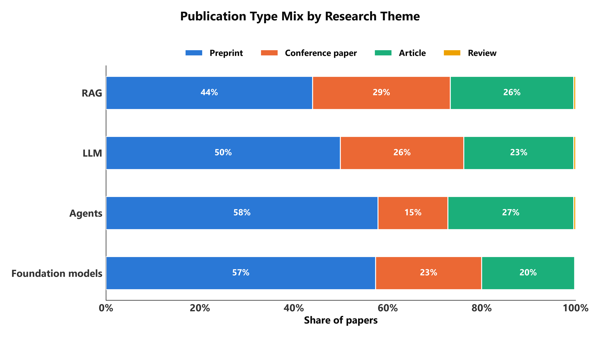
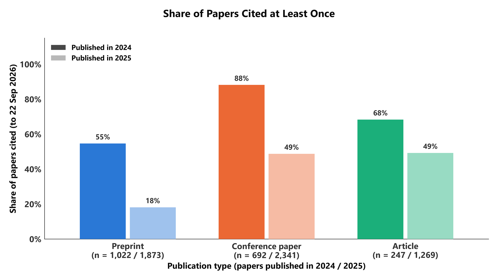
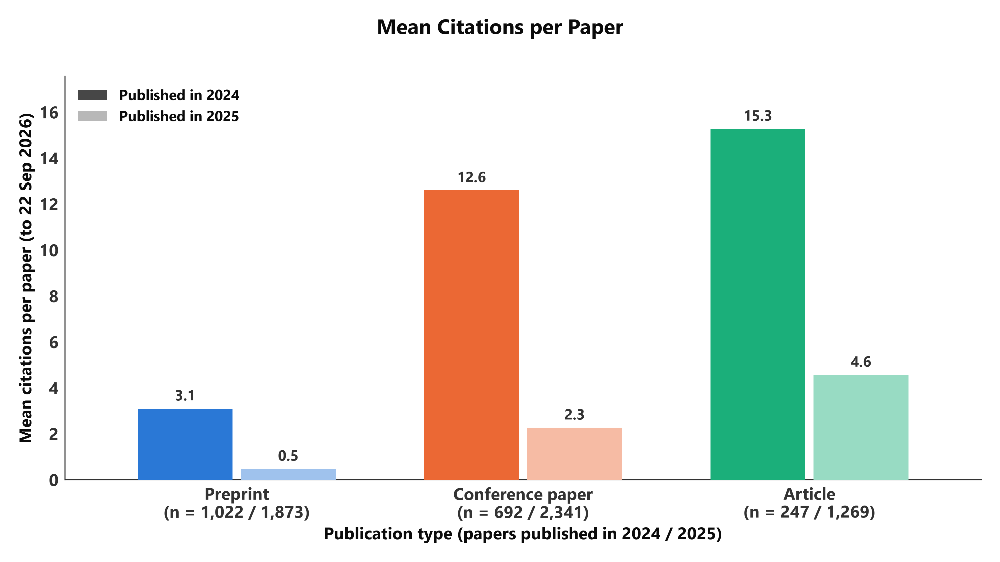
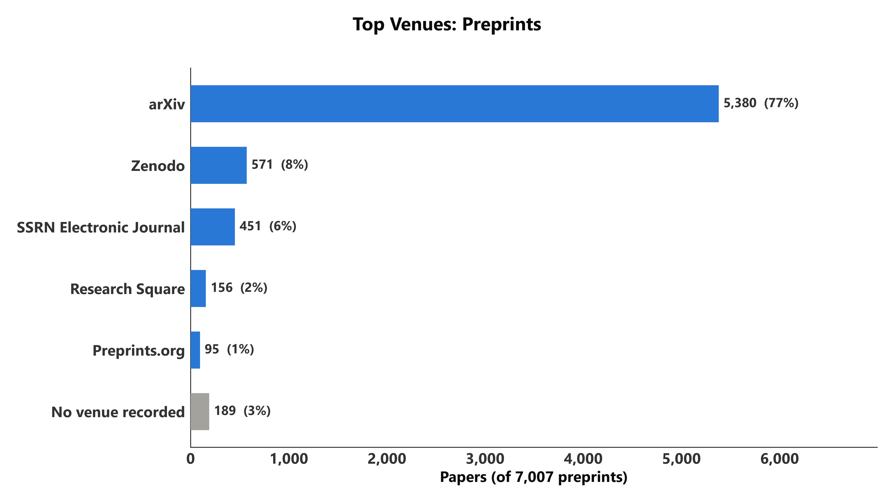
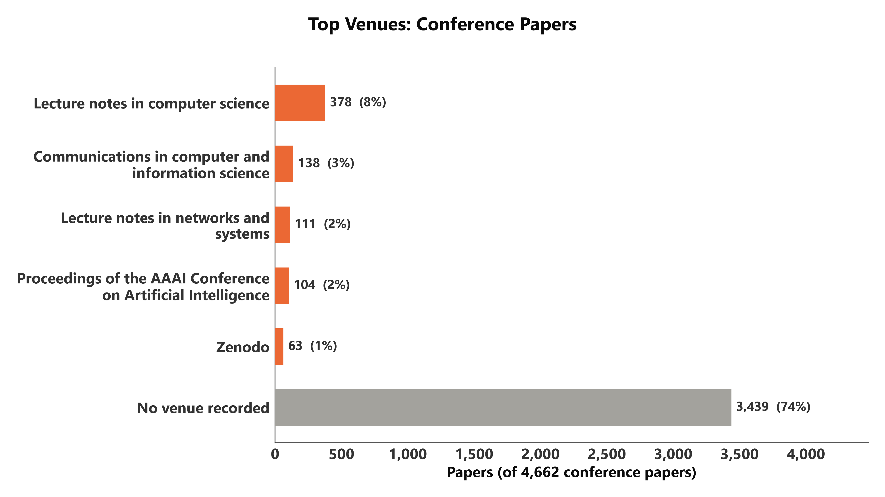
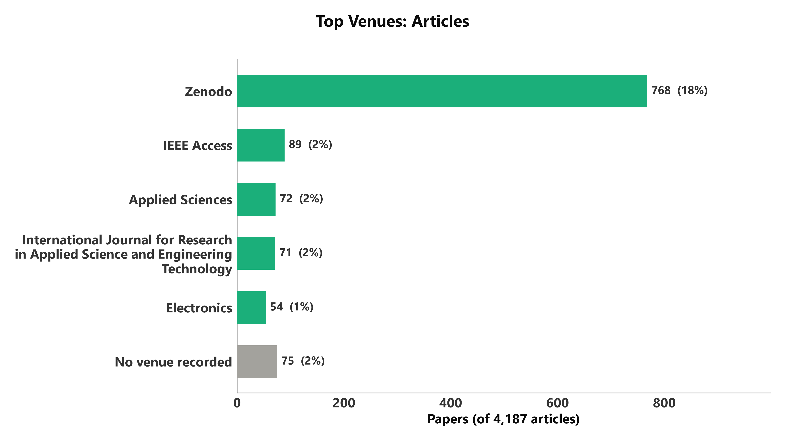

# 方向二：预印本、会议论文、期刊文章

RAG 论文以什么形式发表、这个构成怎么变、不同类型的论文被引情况如何、都发在哪里。

```bash
uv run python analysis/02_publication_types/make_figures.py [--strict | --from-csv]
```

本目录 8 张图：fig1 按季度；fig2、fig2b 类型构成（逐年 / 各主题）；fig3_cited_share、fig3_mean_citations
被引情况；fig4_sources_preprint / _conference_paper / _article 各类型的载体排行。

类型用的是 OpenAlex 的 `type` 字段，语料只包含四类：

| `type` | 篇数 | 图上叫 |
|---|---:|---|
| `preprint` | 7,007 | Preprint |
| `conference-paper` | 4,662 | Conference paper |
| `article` | 4,187 | Article |
| `review` | 65 | Review |

---

## 先看这四个数据坑

1. **`article` 不等于期刊论文。** OpenAlex 把 Zenodo 上的 768 份存档也标成了 `article`（见图 4），
   所以图上写的是 Article 而不是 Journal article。
2. **「预印本比正式发表领先多久」目前答不了。** 数据库里一篇论文只有一条记录，
   没有「同一篇论文的预印本版本和正式版本」的对应关系。
3. **会议论文进 OpenAlex 有几个月的滞后。** 最近两个季度的会议论文偏少是没收录完，不是真的减少。
4. **2,417 篇论文（15.2%）的日期只精确到年**，被统一记成 1 月 1 日。按季度画图时必须剔除（图 1 已剔除）。

---

## 图 1　按季度的发表类型



| | |
|---|---|
| SQL | [`sql/fig1_type_by_quarter.sql`](sql/fig1_type_by_quarter.sql) |
| CSV | [`output/fig1_type_by_quarter.csv`](output/fig1_type_by_quarter.csv) |
| 列 | `quarter` 如 `2025Q3`；`type`；`works` 篇数；`year_only_date` 该年因日期只到年而被剔除的篇数（同一年的每行相同） |

图上能读出的：

- 每季度论文数从 2024 Q1 的 147 篇到 2026 Q2 的 3,062 篇。
- 2026 Q3 只到 9 月 22 日，且会议论文还没收录完，不能当作下降。
- 被剔除的论文：2024 年 262 篇、2025 年 884 篇、2026 年 1,246 篇。

最后两个季度用浅灰底标为 Incomplete*。起始时间在 SQL 的 `DATE '2024-01-01'`。

## 图 2　类型构成：RAG 逐年（fig2），以及与其他主题对比（fig2b）




| | |
|---|---|
| SQL | [`sql/fig2a_type_share_by_year.sql`](sql/fig2a_type_share_by_year.sql)（fig2）、[`sql/fig2b_type_mix_by_theme.sql`](sql/fig2b_type_mix_by_theme.sql)（fig2b） |
| CSV | [`output/fig2a_type_share_by_year.csv`](output/fig2a_type_share_by_year.csv)、[`output/fig2b_type_mix_by_theme.csv`](output/fig2b_type_mix_by_theme.csv) |
| 列 | `works` 篇数；`works_in_year` / `works_in_theme` 分母；`share_pct` 占比 |

图上能读出的：

- fig2：预印本占比 2024 年 52%，2025 年 34%，2026 年 48%。会议论文 2025 年 42%，2026 年 19%（受收录滞后影响）。
- fig2b：四个主题里 RAG 的预印本占比最低（44%），会议论文占比最高（29%）；Agents 的预印本占 58%。

fig2b 的数据来自 `meta.recall_probes`，其他主题只有计数；LLM、Agents、Foundation models 的 n 是几个短语之和，是上限。
2023 年只有 133 篇，占比波动大。

## 图 3　各类型的被引情况（2024 与 2025 两批论文并排）




两张图都是分组柱：每种类型两根柱，**深色是 2024 年发表的，浅色是 2025 年发表的**；
横轴类型名下的 `n = 1,022 / 1,873` 是两年的篇数。

| | |
|---|---|
| SQL | [`sql/fig3_citations_by_type.sql`](sql/fig3_citations_by_type.sql) |
| CSV | [`output/fig3_citations_by_type.csv`](output/fig3_citations_by_type.csv) |
| 列 | `cohort_year` 发表年；`works`；`cited_share_pct` 至少被引一次的比例；`mean_citations` 平均被引；`median_citations` 中位数；`p90_citations` 第 90 百分位；`max_citations` |

老论文有更多时间被引，所以**只在同一发表年内部比较**。被引数截至采集日 2026-09-22。图上能读出的：

- 2024 年发表的：会议论文 88% 被引过，Article 68%，预印本 55%。
- 平均被引：Article 15.3，会议论文 12.6，预印本 3.1。中位数分别是 3、4、1，说明平均数被少数高被引论文拉高。
- 2025 年发表的预印本只有 18% 被引过。

Review 只有 5 篇和 22 篇，留在 CSV 里但没有画。这是相关性，不能读成「发在会议上所以被引多」。

## 图 4　各类型最常见的发表载体（每种类型一张）





每张是该类型的前 5 个载体，加一根灰色的 No venue recorded（没有载体记录的篇数）。

| | |
|---|---|
| SQL | [`sql/fig4_top_sources_by_type.sql`](sql/fig4_top_sources_by_type.sql)（用了窗口函数 `row_number`） |
| CSV | [`output/fig4_top_sources_by_type.csv`](output/fig4_top_sources_by_type.csv) |
| 列 | `rank_in_type` 类型内排名；`source_name` 载体全名；`source_type`；`works`；`share_of_type_pct` 占该类型的比例；`works_in_type`；`works_without_source` 该类型里没有载体记录的篇数 |

图上能读出的：

- 预印本：arXiv 5,380 篇，占预印本的 77%。
- 会议论文：**74%（3,439 篇）在 OpenAlex 里没有载体记录**，所以前 5 名只代表其余 26%：这张图主要说明数据缺口，不代表会议格局。
- Article：排第一的是 Zenodo（768 篇），其次是 IEEE Access（89）、Applied Sciences（72）。

图上的载体名是缩短过的（去掉了括号里的机构名，过长的截断），CSV 里是 OpenAlex 的原名。
CSV 里每类有前 10 名，图上画前 5 名（脚本里的 `head(5)`）。
