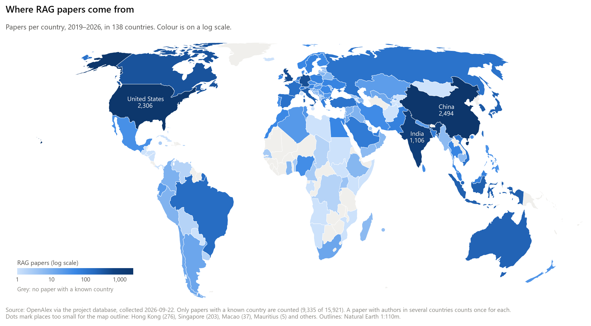
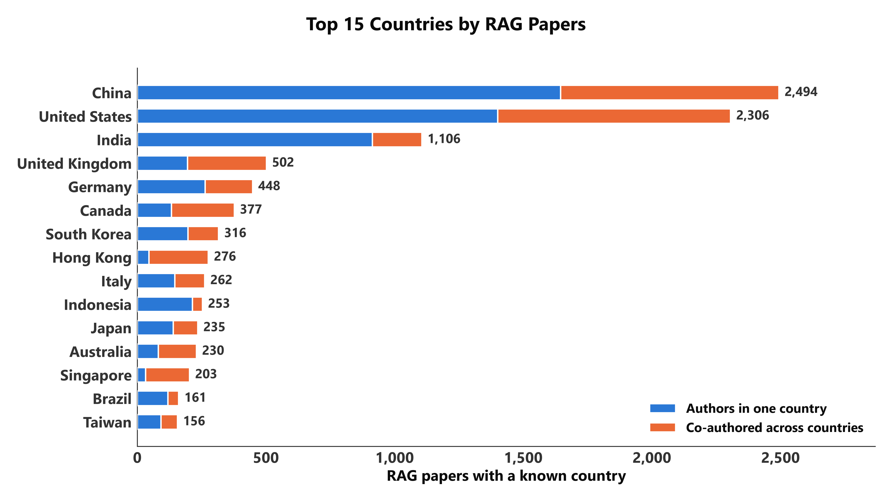
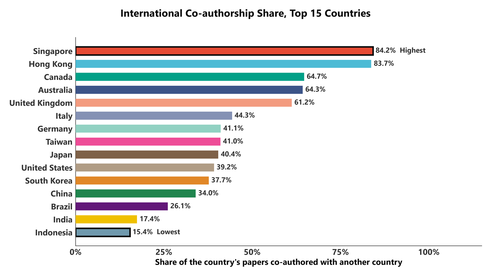
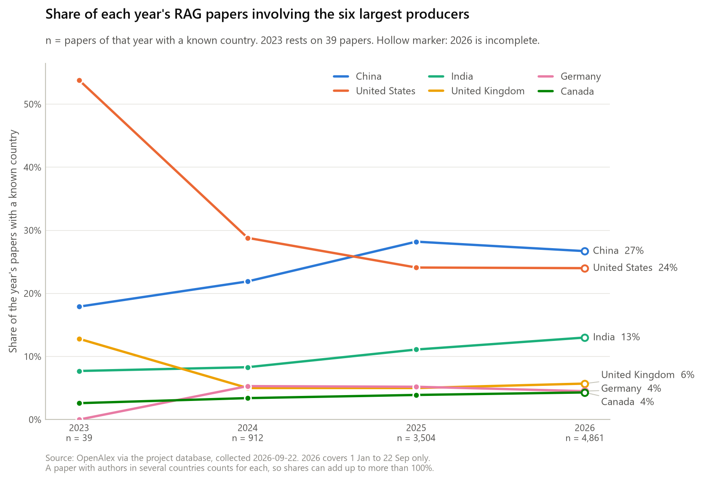
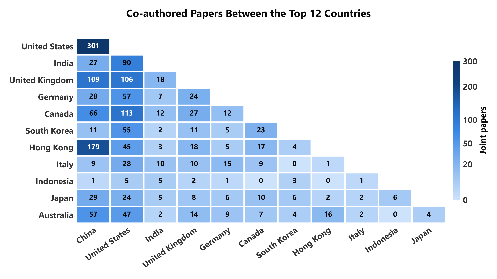
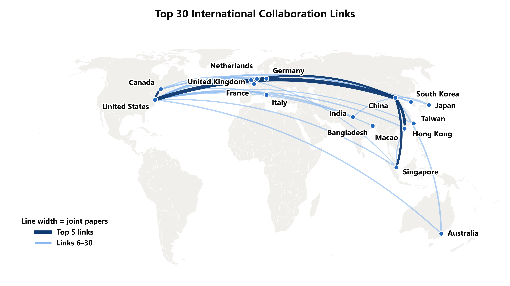
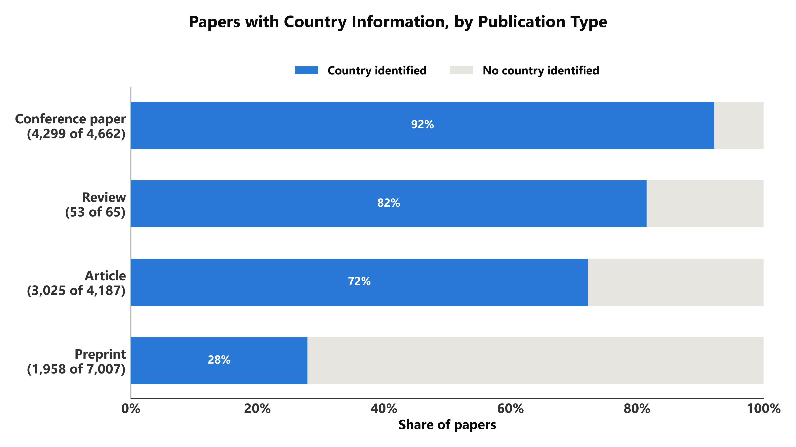
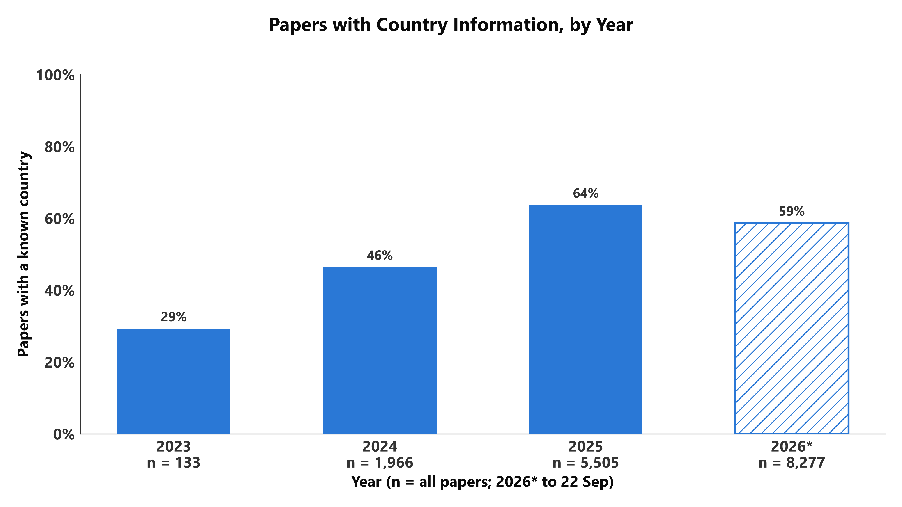

# 方向三：世界分布与国际合作

RAG 研究在哪些国家做、各国份额怎么变、谁和谁合作，以及这些国别数字到底建立在多少论文之上。

```bash
uv run python analysis/03_world_collaboration/make_figures.py [--strict | --from-csv]
```

本目录 8 张图：fig1 地图；fig2a 前 15 名国家（论文数）；fig2b 国际合作比例；fig3 份额逐年；fig4 合作矩阵；fig5 合作连线；fig6a、fig6b 国家信息覆盖率（按类型 / 按年份）。

数据来自 `bridge.work_countries`（每篇论文的作者所在国家）和 `external.country_profiles`（World Bank 的国家档案）。

表中的 CSV（`output/*.csv`）是连库运行时在本地生成的查询结果，不在仓库里。

---

## 先看这四个数据坑

1. **只有 59% 的论文有国家信息**（15,921 篇里的 9,335 篇）。所有国别数字都只建立在这部分论文上，
   而且缺失很不均匀：预印本只有 28% 有国家，会议论文有 92%。**图 6 专门画这件事，引用任何国别结论前先看它。**
2. **一篇多国论文在每个国家各算一次**（full counting）。所以各国论文数相加会超过 9,335，各国份额相加会超过 100%。
3. **台湾要先补进数据库。** World Bank 没有台湾的记录，需要先执行一次
   `country_indicators_analysis/sql/00_add_taiwan.sql`，否则台湾的 156 篇论文在地图上没有名字和坐标。
4. **香港、澳门与中国大陆分开统计**，这是 OpenAlex 和 World Bank 两边共同的口径。

关于地图：国家轮廓用的是 Natural Earth 1:110m 的公开边界数据（`geo/` 目录），只负责画底图，
图上的每个数字仍然来自数据库。没有用 Plotly 自带的地图，因为它把台湾并进了中国，无法单独上色。

---

## 图 1　世界地图：各国 RAG 论文数



| | |
|---|---|
| SQL | [`sql/fig1_papers_by_country.sql`](sql/fig1_papers_by_country.sql) |
| CSV | `output/fig1_papers_by_country.csv`（138 个国家和地区的完整排名） |
| 列 | `rank`；`country_code` 二字码；`iso3_code`；`country`；`region`、`income_level` World Bank 的地区和收入分组；`papers`；`share_of_attributed_pct` 占「有国家信息的论文」的比例；`latitude`、`longitude` 首都坐标 |

图上能读出的：

- 前五名：中国 2,494、美国 2,306、印度 1,106、英国 502、德国 448。
- 138 个国家和地区至少有一篇。台湾 156 篇，排第 15。
- 颜色是对数刻度，否则除了中美印之外全是浅色。

底图太小画不出的 8 个地方用圆点表示：香港 276、新加坡 203、澳门 37、毛里求斯 5、巴林 3、开曼群岛 3、马耳他 1、摩纳哥 1。

想改：按地区或收入分组汇总，直接对 CSV 的 `region` / `income_level` 求和即可。

## 图 2　前 15 名国家（fig2a），以及国际合作的比例（fig2b）




fig2a 按论文数排序，蓝色是作者全在本国、橙色是跨国合作。fig2b 按合作比例从高到低排，百分比保留一位小数，
每个国家一种颜色（Nature 色板，见 `common.py` 的 `NATURE`，颜色只用来区分柱子，没有含义），最高、最低用黑框标出。

| | |
|---|---|
| SQL | [`sql/fig2_top_countries_collab.sql`](sql/fig2_top_countries_collab.sql) |
| CSV | `output/fig2_top_countries_collab.csv` |
| 列 | `papers` 总数；`domestic_only` 作者全在本国；`international` 至少还有一个别国作者；`international_share_pct`；`all_papers_with_country`、`all_international_papers` 全语料的两个总数（每行相同） |

图上能读出的：

- 全语料有国家信息的论文里，23%（2,176 篇）涉及一个以上的国家。
- 国际合作比例最高的是新加坡 84.2% 和香港 83.7%（基本并列），其次加拿大 65%、澳大利亚 64%、英国 61%。
- 比例最低的是印度尼西亚 15% 和印度 17%。中国 34%，美国 39%。

想看前 20 名，改 SQL 最后的 `LIMIT 15`。

## 图 3　前六名国家的份额逐年变化



| | |
|---|---|
| SQL | [`sql/fig3_country_share_by_year.sql`](sql/fig3_country_share_by_year.sql) |
| CSV | `output/fig3_country_share_by_year.csv` |
| 列 | `overall_rank` 该国的总排名；`papers` 该国该年论文数；`papers_with_country` 该年有国家信息的论文数（分母）；`share_pct` |

图上没有图例，国家名标在每条线的末端。图上能读出的：

- 中国：2024 年 22%，2025 年 28%，2026 年至今 27%。美国：29%、24%、24%。中国在 2025 年超过美国。
- 印度从 2024 年的 8% 升到 2026 年的 13%。

**2023 年只有 39 篇有国家信息**，那一年美国的 54% 是 21 篇，不要当成趋势的起点。
CSV 里 2023 年没有德国的行，因为那年是 0 篇。

## 图 4　前 12 名国家两两合作的论文数



| | |
|---|---|
| SQL | [`sql/fig4_collab_matrix.sql`](sql/fig4_collab_matrix.sql)（`bridge.work_countries` 自连接） |
| CSV | `output/fig4_collab_matrix.csv` |
| 列 | 每对国家出现两行（A-B 和 B-A）。`joint_papers` 合作论文数；`papers_a` A 国总论文数；`share_of_a_pct` 合作论文占 A 国论文的比例 |

图上能读出的：

- 中国-美国 301 篇，远高于其他任何一对。其次中国-香港 179、加拿大-美国 113、中国-英国 109、英国-美国 106。
- 印度与美国 90 篇，与中国 27 篇。

图上只画了下三角，每对国家出现一次。想按「占本国论文的比例」上色，把脚本里的 `joint_papers` 换成 `share_of_a_pct`（那时矩阵不再对称，要画全矩阵）。

## 图 5　世界地图上的合作连线



| | |
|---|---|
| SQL | [`sql/fig5_collab_pairs.sql`](sql/fig5_collab_pairs.sql) |
| CSV | `output/fig5_collab_pairs.csv`（合作最多的 30 对国家） |
| 列 | `rank`；两国的代码和名称；`joint_papers`；两国首都的经纬度 |

线越粗合作论文越多；**合作最多的 5 对用深蓝粗线**，其余 25 对用浅蓝。连线画在首都之间，是示意用的曲线，不是真实路径。

国名标签的位置是在脚本的 `place` 字典里手工调的（欧洲和东亚的首都挤在一起）。
如果改了 SQL 的 `LIMIT 30` 导致出现新的国家，新国家会用默认位置，可能需要在 `place` 里补一行。

## 图 6　偏差检查：多少论文有国家信息（fig6a 按类型，fig6b 按年份）




fig6b 里 2026* 的柱子画成斜线填充，表示数据只到 9 月 22 日、新论文的单位信息还在补全。

| | |
|---|---|
| SQL | [`sql/fig6a_coverage_by_type.sql`](sql/fig6a_coverage_by_type.sql)、[`sql/fig6b_coverage_by_year.sql`](sql/fig6b_coverage_by_year.sql) |
| CSV | `output/fig6a_coverage_by_type.csv`、`output/fig6b_coverage_by_year.csv` |
| 列 | `works` 总数；`with_country`、`with_country_pct` 有国家信息的篇数和比例；`with_affiliation_text`（仅 6a）作者位上有单位原文的篇数 |

图上能读出的：

- 预印本只有 28% 有国家信息，会议论文 92%，Article 72%。
- 按年份：2024 年 46%，2025 年 64%，2026 年至今 59%。

这意味着前面几张图主要反映的是会议论文和期刊文章，占语料 44% 的预印本大部分没有被算进去。
缺失的原因在 6a 的最后两列：没有国家的论文，基本就是作者位上连单位原文都没有的论文，无法补救。
哪些国家因此被低估，这份数据回答不了。
