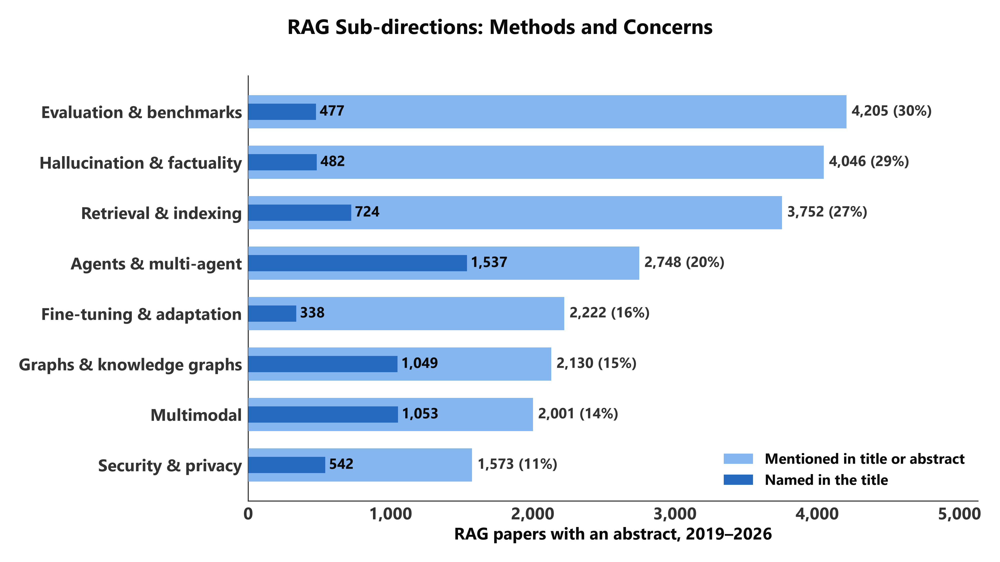
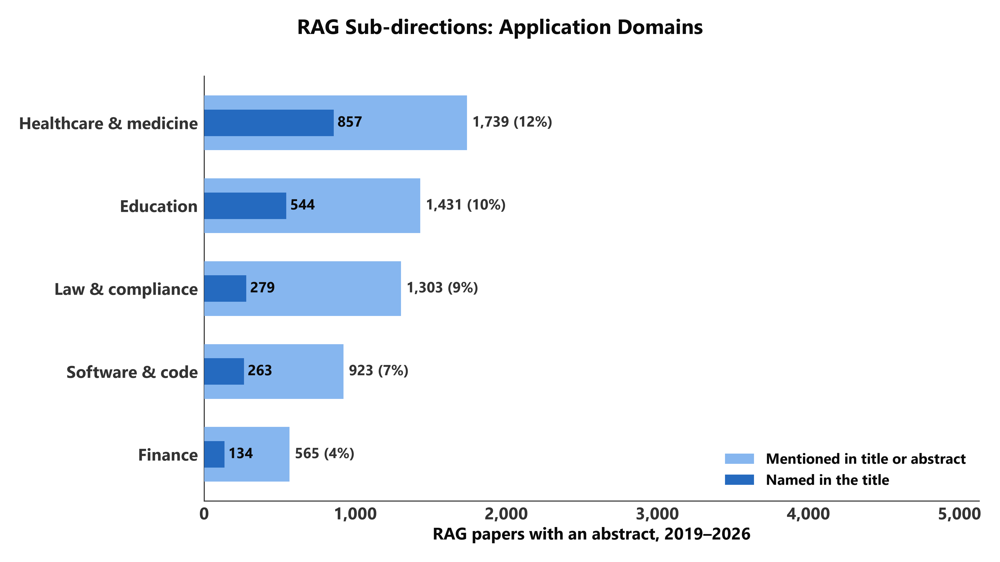
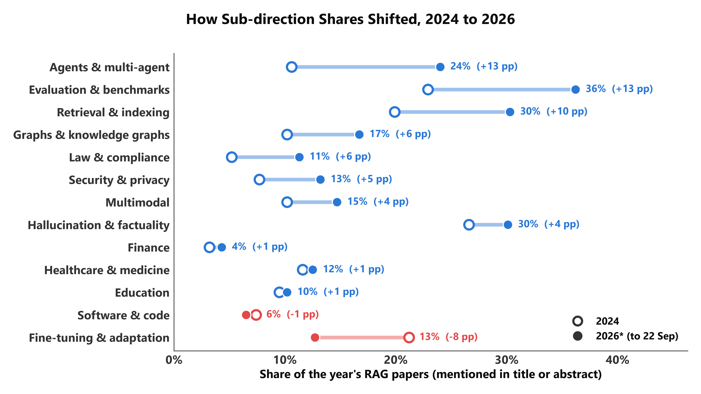
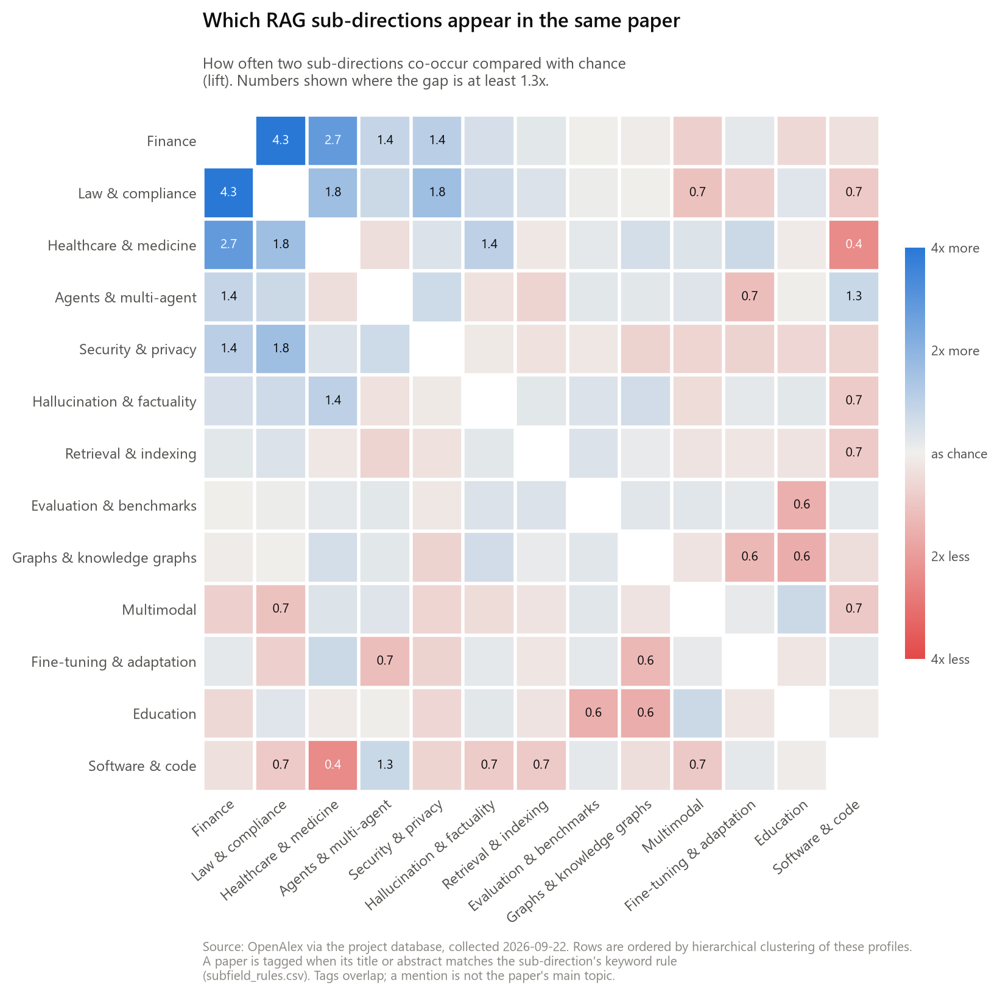

# 方向四：RAG 内部的子方向

RAG 研究内部分成哪些方向、各有多大、哪些在升温、哪些经常一起出现。

```bash
uv run python analysis/04_subfields/make_figures.py [--strict | --from-csv]
```

本目录 4 张图：fig1_sizes_method、fig1_sizes_application（两组子方向的规模）、fig2_subfield_share_shift（占比变化）、fig3_subfield_cooccurrence（共现）。

---

## 这里做的不是聚类，是规则打标签

OpenAlex 自带的主题和关键词用不了：四千多篇论文被归到 "Topic Modeling"，
关键词里混着 "Context (archaeology)"、"Key (lock)" 这类明显的误标。
向量聚类需要额外建模，这次没有做。

所以这里用的是**关键词规则**：[`subfield_rules.csv`](subfield_rules.csv) 里每行一个子方向和一条正则表达式，
论文的标题或摘要匹配上就打上这个标签。匹配是在数据库里用 SQL 的 `~*` 完成的。

**三件必须知道的事：**

1. **标签是「提到」，不是「主题是」。** 一篇摘要里写「RAG 可以减少幻觉」的论文会被打上 Hallucination，
   哪怕它研究的是别的。所以每张图都同时给出两个口径：
   - **标题或摘要匹配**（宽）：提到了这个方向。
   - **标题匹配**（严）：论文自己把它写进了标题。
2. **标签不互斥。** 一篇论文平均有 2.0 个标签，11% 的论文一个也没有。各方向的占比相加远超 100%。
3. **只用了有摘要的 13,969 篇**，另外 1,952 篇没有摘要的论文不参与，这样每篇论文被匹配的机会相同。

### 怎么改规则

直接编辑 `subfield_rules.csv`，然后重跑脚本，所有图和 CSV 都会跟着变。

| 列 | 含义 |
|---|---|
| `subfield` | 内部编号，不要重复 |
| `label` | 图上显示的名字 |
| `kind` | `method`（方法与关注点）或 `application`（应用领域），决定图 1 分在哪一张 |
| `pattern` | PostgreSQL 正则表达式，不区分大小写 |

正则里几个常用写法：`a|b` 是「a 或 b」；`-?` 表示连字符可有可无（`fine-?tun` 同时匹配 fine-tune 和 finetune）；
`\m` 和 `\M` 是单词的开头和结尾（`\magents?\M` 匹配 agent、agents，但不匹配 reagent）。

新增一个方向就加一行；删除一行就去掉一个方向。改完建议看一眼 `fig1_subfield_sizes.csv`，
如果某个方向的占比高得不合理，多半是某个词太宽了。

---

## 图 1　各子方向的论文数（方法与关注点、应用领域各一张）




浅蓝宽柱是「标题或摘要」口径，深蓝窄柱是「标题」口径；两张图横轴同为 0–5,000，可以直接比大小。

| | |
|---|---|
| SQL | [`sql/fig1_subfield_sizes.sql`](sql/fig1_subfield_sizes.sql)、[`sql/fig1b_tagging_coverage.sql`](sql/fig1b_tagging_coverage.sql)（覆盖率总数，写在下面） |
| CSV | [`output/fig1_subfield_sizes.csv`](output/fig1_subfield_sizes.csv)、[`output/fig1b_tagging_coverage.csv`](output/fig1b_tagging_coverage.csv) |
| 列 | `papers` 标题或摘要匹配的篇数；`papers_title` 标题匹配的篇数；`papers_with_abstract` 分母；`share_pct`、`share_title_pct` 两个口径的占比 |

图上能读出的：

- 按「提到」算，最大的三个是 Evaluation（30%）、Hallucination（29%）、Retrieval（27%）。
- 按「写进标题」算，排名完全不同：Agents 1,537 篇最多，其次 Multimodal 1,053、Graphs 1,049、Healthcare 857。
- 两个口径差距最大的是 Evaluation 和 Hallucination：四千多篇提到，不到五百篇写进标题。
  它们更像是 RAG 论文普遍会提的话题，而不是独立的方向。

规则覆盖：13,969 篇里 12,404 篇（89%）至少匹配一条规则；按标题算是 6,765 篇（48%）。

## 图 2　2024 到 2026 年，各子方向的占比怎么移动（哑铃图）



| | |
|---|---|
| SQL | [`sql/fig2_subfield_share_by_year.sql`](sql/fig2_subfield_share_by_year.sql) |
| CSV | [`output/fig2_subfield_share_by_year.csv`](output/fig2_subfield_share_by_year.csv) |
| 列 | `year`；`papers`、`papers_title` 两个口径的篇数；`papers_with_abstract` 该年有摘要的论文数（分母）；`share_pct`、`share_title_pct` |

每个子方向一行：空心点是 2024 年占比，实心点是 2026 年至今，按「标题或摘要」口径；蓝色是上升、红色是下降，
按变化从大到小排。右侧标的是 2026 年占比和变化（百分点）。它替代了原来每个子方向一张的 13 张折线图和那张变化条形图。
图上能读出的：

- Agents 升得最多：11% → 24%（+13 pp）。
- Evaluation 也是 +13 pp，但只看标题时几乎不变（见下面的表）。
- Fine-tuning 是唯一明显下降的：21% → 13%（−8 pp）。
- Healthcare、Education 基本持平。

**只看标题的变化**没有画进图，数字在 [`output/fig4_subfield_share_change.csv`](output/fig4_subfield_share_change.csv)
（SQL：[`sql/fig4_subfield_share_change.sql`](sql/fig4_subfield_share_change.sql)），
列是 `share_2024_pct` / `share_2025_pct` / `share_2026_pct`、`change_pp`，以及同样的 `*_title_*` 列：

- Agents：+13.4 pp，标题口径 +9.0，两个口径一致，说明它确实在成为论文主题。
- Evaluation：+13.2 pp，标题口径只有 +1.0：提到评测的论文多了很多，专门做评测的论文没怎么变。
- Fine-tuning：−8.5 pp，标题口径 −1.9。

**为什么几乎所有方向都是上升：** 摘要平均长度从 2024 年的 1,322 个字符涨到 2026 年的 1,489 个（+13%，
见 `output/fig4b_abstract_length_by_year.csv`），摘要越长能提到的东西越多，「提到」口径的占比会普遍上浮一点。
标题变长得少得多（88 → 94 个字符），标题口径更稳。下结论时以两个口径方向一致的为准。

CSV 里有 2023 年的行，但那年只有一百多篇，图上从 2024 年开始。

## 图 3　哪些子方向经常一起出现



| | |
|---|---|
| SQL | [`sql/fig3_subfield_cooccurrence.sql`](sql/fig3_subfield_cooccurrence.sql)（标签表自连接） |
| CSV | [`output/fig3_subfield_cooccurrence.csv`](output/fig3_subfield_cooccurrence.csv) |
| 列 | 每对方向出现两行。`papers_both` 同时带两个标签的篇数；`papers_a`、`papers_b` 各自的篇数；`share_of_a_pct` 占 A 的比例；`lift` 见下 |

`lift` 是「实际同时出现的次数 ÷ 如果两者无关时预期的次数」。1.0 表示和随机一样，2.0 表示多一倍，0.5 表示少一半。
蓝色高于随机，红色低于随机。图上能读出的：

- 应用领域之间抱团最明显：Finance 与 Law 4.3 倍，Finance 与 Healthcare 2.7 倍，Healthcare 与 Law 1.8 倍。
- Security 与 Law 1.8 倍。
- 明显少于随机的：Healthcare 与 Software 0.4 倍，Agents 与 Fine-tuning 0.7 倍。

行列的顺序是按层次聚类排的（共现模式相近的排在一起），这是整个方向里唯一用到聚类的地方，
而且聚的是 13 个标签，不是论文。改了规则之后顺序会变。
Finance 只有 565 篇，涉及它的倍数建立在较少的论文上。

---

## 如果以后要做真正的聚类

数据库已经装了 pgvector，依赖里也有 sentence-transformers。路径是：把 13,969 篇摘要向量化存进数据库，
聚类后给每个簇起名字。这套规则标签可以反过来当作检验：聚出来的簇和这里的标签对不对得上。
