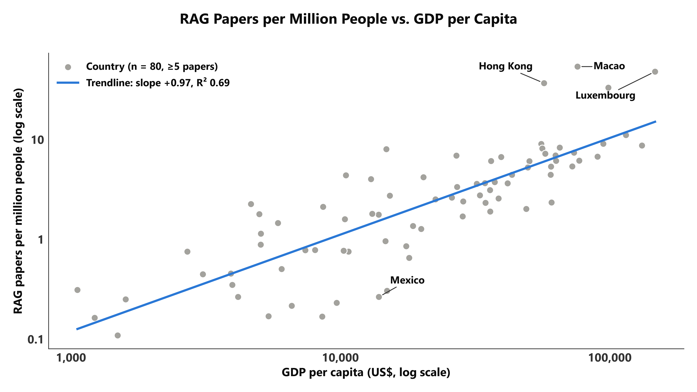
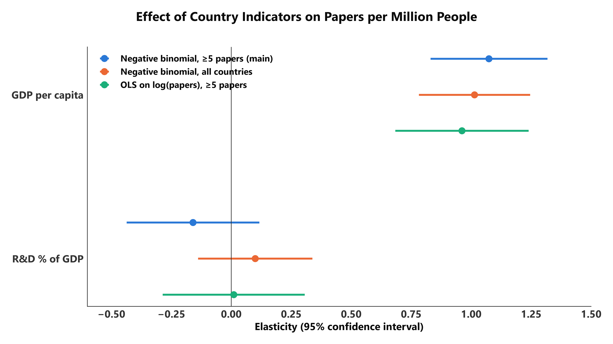
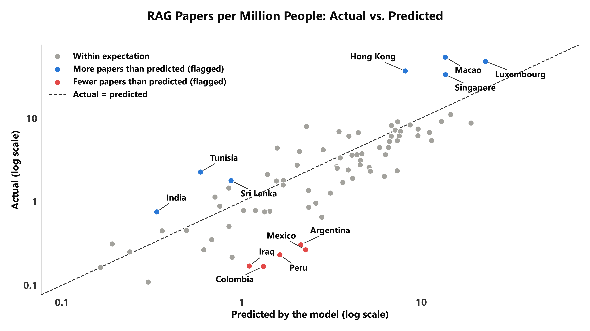

# RAG research output and country indicators

**Question.** Do richer countries, countries that invest more in R&D, and larger countries publish
more research on Retrieval-Augmented Generation (RAG)? And which countries do not fit the pattern?

**Short answer.**

- **Wealth is the strongest predictor.** Per person, RAG output rises about one-for-one with GDP per
  capita: a country twice as rich publishes about twice as many papers per million people.
- **Size matters about proportionally.** Holding wealth fixed, 10% more population goes with
  roughly 8–9% more papers.
- **R&D intensity adds little once wealth and size are known.** R&D spending (% of GDP) looks
  important on its own, but mainly because rich countries spend more on R&D. Its independent
  effect is small and not statistically significant in any of the main models.
- **The outliers are informative.** City economies (Hong Kong, Macao, Singapore, Luxembourg) and
  English-speaking IT economies (India, Sri Lanka) publish far more than predicted. Latin American
  countries (Mexico, Argentina, Colombia, Peru) publish far less.

---

## 1. Data

| | |
|---|---|
| Papers | 15,921 RAG papers (title or abstract mentions "retrieval augmented generation"), computer science, 2019-01-01 to 2026-09-22, from OpenAlex |
| Outcome | Number of distinct papers with at least one author from the country, **all years combined** |
| Indicators | World Bank: GDP per capita (current US$), R&D expenditure (% of GDP), population |
| Indicator year | Each country's **most recent available value**, assumed constant over the whole period |
| Taiwan | Not in the World Bank data; added from Taiwan's official statistics (`sql/00_add_taiwan.sql`) |
| Researchers per million | Not used: missing for the UK, Australia, Brazil and Israel among others |

Two samples are used:

| Sample | Countries | Role |
|---|---:|---|
| **≥5 papers** with all three indicators | 80 | Main analysis, outliers |
| **All countries** with all three indicators (12 have zero papers) | 116 | Reference |

Twelve countries with ≥5 papers have no R&D figure and cannot be included. The largest are
Bangladesh (87 papers) and Morocco (48), followed by Ecuador, Nepal, Jordan, Lebanon, Ethiopia,
Ghana, Cambodia, Madagascar, Yemen, and West Bank and Gaza.

## 2. Method

Paper counts are highly skewed: from 5 papers up to 2,494 for China. The model is therefore a
**negative binomial regression**, a standard model for over-dispersed counts. All indicators enter
in logarithms, so each coefficient is an **elasticity**: the % change in papers for a 1% change in
the indicator, holding the others fixed.

| Model | Outcome | Specification |
|---|---|---|
| Total | papers | log GDP per capita + log R&D % + log population |
| Per capita | papers per million people | log GDP per capita + log R&D %, with log population as an *offset* |

The per-capita model is the total model with the population elasticity fixed at exactly 1.
Comparing the two therefore also tests whether output is proportional to country size.

As a cross-check, an ordinary least squares (OLS) regression on log(papers) was also fitted to the
≥5 sample. It gives the **same picture**: same signs, GDP per capita and population significant,
R&D not significant at 5%. It is shown in green in Figure 3 and not discussed further.

## 3. Results

### 3.1 One indicator at a time



*Figure 1. Each indicator on its own, countries with ≥5 papers, log–log axes, one figure per pair:
`fig1_trend_papers_vs_{gdp_pc,rd_pct,pop_m}.png` and `fig1_trend_papers_per_m_vs_{gdp_pc,rd_pct}.png`.
The straight line is a power-law trendline. Labelled: the three countries furthest from it and the two
largest values, each tied to its point by a leader line. These figures are descriptive; the slopes do
not control for the other indicators. Papers per million vs population is not drawn: its slope is
simply (papers vs population) − 1 = 0.54 − 1 = −0.46. Its row stays in
`trendlines_single_indicator.csv`.*

- **Total papers.** On their own, population (R² 0.38) and R&D intensity (R² 0.29) track output
  best. GDP per capita alone explains little (R² 0.08) because the two largest producers, China and
  India, are not rich per head.
- **Papers per million people.** GDP per capita alone explains 69% of the variation, with a slope of
  almost exactly 1.

### 3.2 Negative binomial models

| Elasticity [95% CI] | Total, ≥5 papers | Total, all countries | Per capita, ≥5 papers | Per capita, all countries |
|---|---|---|---|---|
| GDP per capita | **0.76** [0.49, 1.04] | **0.91** [0.65, 1.18] | **1.07** [0.83, 1.32] | **1.01** [0.78, 1.25] |
| R&D % of GDP | 0.10 [−0.20, 0.39] | 0.18 [−0.08, 0.43] | −0.16 [−0.44, 0.12] | 0.10 [−0.14, 0.34] |
| Population | **0.79** [0.68, 0.90] | **0.92** [0.80, 1.04] | fixed at 1 | fixed at 1 |
| n | 80 | 116 | 80 | 116 |

Bold: p < 0.001. R&D is not significant in any column (p between 0.17 and 0.53). Standard errors
are robust to heteroscedasticity.

**How to read the coefficients (main model, ≥5 papers):**

- **GDP per capita, 0.76.** A country 10% richer per head publishes about **7.6% more** RAG papers.
  Doubling GDP per capita multiplies output by about **1.7**. Per person the elasticity is about 1:
  double the income, double the papers per million inhabitants.
- **Population, 0.79.** 10% more people goes with about **7.8% more** papers. In the ≥5 sample this
  is significantly below 1 (p = 0.0003), so larger countries publish slightly less per head. In the
  all-countries sample it is 0.92 and **not** significantly different from 1 (p = 0.19). The evidence
  for "less than proportional" therefore depends on the ≥5 filter, which removes small countries
  with low output. Output roughly proportional to population is a fair summary.
- **R&D % of GDP, about 0.1.** Doubling R&D intensity at the same wealth and size goes with only
  about 7% more papers, and the estimate is not distinguishable from zero. R&D intensity is strongly
  correlated with GDP per capita (r = 0.75), so most of its apparent effect in Figure 1 is wealth.
  A plausible reason is that R&D % mostly measures industrial R&D (semiconductors, pharma, cars),
  while RAG is cheap, software-only research that needs little laboratory investment.

### 3.3 ≥5 papers vs all countries



*Figure 3. Elasticities with 95% confidence intervals: the two negative binomial models, plus the
OLS cross-check. One figure per outcome: `fig3_coefficients_total.png`, `fig3_coefficients_per_capita.png`.*

- **No significant differences.** None of the five coefficients differs significantly between the
  two samples (all p > 0.13). Every confidence interval overlaps the other model's estimate.
- **The all-countries estimates are a little larger** for GDP per capita (0.91 vs 0.76) and
  population (0.92 vs 0.79). That is what the ≥5 filter should do: dropping low-output countries
  flattens the slopes slightly.
- **R&D changes sign in the per-capita model** (−0.16 vs 0.10), but both estimates are close to zero
  and not significant.

**Conclusion: the ≥5 restriction does not change the findings.**

### 3.4 Outliers



*Figure 2 (`fig2_actual_vs_predicted_total.png`, `fig2_actual_vs_predicted_per_capita.png`). Actual vs predicted output from the main (≥5) negative binomial models. A country is
flagged when its studentized deviance residual is beyond ±2, or when it strongly influences the fit
(Cook's distance > 4/n). Countries on the dashed line publish exactly what their indicators predict.*

| Country | Papers | Predicted | Actual ÷ predicted | Indicators |
|---|---:|---:|---:|---|
| **More than predicted** | | | | |
| Hong Kong | 276 | 58 | 4.8× | rich, R&D 1.1%, 7.5 M people |
| Macao | 37 | 10 | 3.8× | rich, R&D 0.3%, 0.7 M people |
| India | 1,106 | 345 | 3.2× | US$2.7k per head, R&D 0.65% |
| Singapore | 203 | 79 | 2.6× | rich, R&D 1.8%, 6 M people |
| Sri Lanka | 39 | 17 | 2.3× | US$5.0k per head, R&D 0.1% |
| Tunisia | 28 | 12 | 2.3× | US$4.7k per head, R&D 0.75% |
| China | 2,494 | 1,330 | 1.9× | influential (largest producer) |
| Luxembourg* | 33 | 16 | 2.1× | richest country in the sample |
| **Fewer than predicted** | | | | |
| Argentina | 14 | 82 | 0.17× | US$14.9k per head, R&D 0.6% |
| Colombia | 9 | 56 | 0.16× | US$8.6k per head |
| Mexico* | 35 | 299 | 0.12× | US$13.9k per head, 132 M people |
| Peru* | 8 | 56 | 0.14× | |
| Iraq* | 8 | 52 | 0.15× | |

\* flagged in the per-capita model only. Predicted values are from the total model, except for the
starred countries (per-capita model).

The flagged countries fall into three groups. The explanations below are hypotheses for
discussion; the models do not test them.

1. **City economies: Hong Kong, Macao, Singapore, Luxembourg.** Their research output comes from a
   few internationally oriented, English-language universities (HKU, HKUST, CUHK, NUS, NTU and
   others). Those universities recruit globally, so the small local population understates the
   talent pool. They also have only average R&D intensity, so their output is driven by universities
   rather than national R&D budgets. Their high per-head numbers are also helped by full counting
   (see limitations), because their papers often have international co-authors.
2. **English-speaking IT economies: India, Sri Lanka, and Tunisia.** These countries have large
   software and IT-services sectors and strong computer-science education, but low GDP per capita
   and low R&D spending. RAG needs a laptop and API access rather than a laboratory, so these
   economies can contribute well above what their income level predicts. **China** is above its
   prediction too, which fits its national priority on AI.
3. **Latin America: Mexico, Argentina, Colombia, Peru.** These middle-income countries publish only
   one-sixth to one-eighth of what their indicators predict. Possible reasons are less publishing
   in English-language computer-science venues and on arXiv, a smaller AI industry, or weaker
   affiliation metadata in OpenAlex. Since Iraq is also flagged, this is not only a regional effect.

**Sensitivity.** Dropping the seven influential countries (Hong Kong, Macao, India, Singapore, Sri
Lanka, Tunisia, China) changes the estimates:

| | All 80 | Without the 7 |
|---|---|---|
| GDP per capita | 0.76 | 0.62 |
| Population | 0.79 | 0.77 |
| R&D % of GDP | 0.10 (p = 0.53) | **0.27 (p = 0.01)** |

Most over-producers have low or average R&D intensity (Hong Kong 1.1%, Macao 0.3%, India 0.65%,
Sri Lanka 0.1%; the sample median is 1.0%), and they pull the R&D slope towards zero. Among the
"typical" countries, R&D intensity does have a modest positive effect: doubling it goes with about
20% more papers. The effect is real but secondary to wealth and size, and a handful of unusual
countries can cancel it.

## 4. Conclusions

1. **GDP per capita is the main and most robust predictor** of RAG output. Per person, output is
   roughly proportional to income (elasticity about 1 in every specification).
2. **Country size works roughly proportionally** (elasticity 0.8–0.9). Large countries publish more
   in total, but not much more per head.
3. **R&D intensity is not a significant independent predictor** in the main models. Its
   single-indicator correlation mostly reflects wealth. A modest positive effect appears once the
   unusual high-output, low-R&D countries are set aside.
4. **The findings are robust.** They are similar for the ≥5-paper sample and the all-countries
   sample, and for the negative binomial and log-linear models.
5. **The outliers show where the economic model breaks down.** City economies with global
   universities and English-speaking IT economies overperform; Latin America underperforms. Factors
   such as language, university internationalisation and the software-industry base matter for this
   field beyond money spent on R&D.

## 5. Limitations

1. **41% of papers have no country.** 6,586 of the 15,921 papers have no usable affiliation in
   OpenAlex, so the counts are a large sample of each country's output, not the total. If missing
   affiliations are more common in some countries or venues, those countries are undercounted. This
   could partly explain the Latin American gap.
2. **A paper can be counted for several countries (full counting).** A paper with authors from three
   countries counts once for each, so the 9,335 papers that have a country produce 12,238 country
   credits. This favours internationally collaborative places, such as small city economies.
3. **Taiwan was added manually, and one value is not from a fully official source.** GDP per capita
   (DGBAS, 2025, preliminary) and population (Ministry of the Interior household registration, end
   of 2025) come from government sources. The R&D share (4.10%, 2024) is the NSTC survey figure as
   reported in the press, because the NSTC table itself could not be retrieved. Definitions also
   differ slightly from the World Bank's (for example, registered vs mid-year population).
4. **Most recent indicators are treated as constant.** Each country uses its latest available value,
   assumed unchanged from 2019 to 2026. The years differ between countries: R&D values range from
   2019 to 2024 (62 of 80 countries use 2023 or 2024), and GDP is mostly 2025. GDP in current US$
   also moves with exchange rates. Since 99% of the papers appeared in 2024–2026, the most recent
   values are the most relevant, but this is still an approximation.
5. **Sample selection.** The ≥5 filter selects on the outcome, which slightly flattens the slopes
   (section 3.3). Countries that do not report R&D spending, mostly lower-income ones, cannot be
   included at all. The all-countries sample therefore contains only 12 zero-paper countries and
   under-represents low-output countries.
6. **Association, not causation.** This is a cross-section of countries. GDP per capita and R&D
   intensity are correlated (r = 0.75; variance inflation factors at most 3.6, which is acceptable),
   so their separate effects are estimated less precisely than their joint effect.
7. **Hong Kong and Macao are counted separately from mainland China**, following both OpenAlex and
   the World Bank.
8. **The 2026 data is incomplete.** It runs to 22 September, and recent conference papers are still
   being indexed. This affects all countries similarly, so it matters little for a cross-country
   comparison.

## 6. Files and how to run

```
country_indicators_analysis/
├── README.md                          this report
├── country_indicators_analysis.py     the analysis (data loading, models, figures, tables);
│                                      figure style from analysis/common.py (a copy ships in the zip)
├── sql/
│   ├── 00_add_taiwan.sql              one-off: inserts Taiwan into the database
│   ├── 01_country_paper_counts.sql    papers per country      (bridge.work_countries)
│   ├── 02_country_indicators.sql      World Bank indicators   (external.country_indicators)
│   └── 03_country_profiles.sql        names, regions, income  (external.country_profiles)
└── output/                            (CSV files are written by each run, not committed)
    ├── fig1_trend_*.png (5), fig2_actual_vs_predicted_{total,per_capita}.png,
    │   fig3_coefficients_{total,per_capita}.png   (300 dpi, 4000×2250, each with a PDF twin)
    ├── 01_country_paper_counts.csv    what sql/01 returned  ┐ saved by every database run;
    ├── 02_country_indicators.csv      what sql/02 returned  │ --from-csv reads these three
    ├── 03_country_profiles.csv        what sql/03 returned  ┘ instead of querying
    ├── country_table.csv              one row per country: indicators, years used, papers
    ├── coefficients.csv               all model coefficients with CIs
    ├── comparison_nb_ge5_vs_all.csv   the section 3.3 comparison
    ├── outliers.csv                   residuals, Cook's distance, actual/predicted per country
    └── trendlines_single_indicator.csv
```

**Run.** The script reads everything from the project database with the three queries in `sql/`,
so the database has to be up first (repo README, Route A). From the repo root:

1. Once per database, add Taiwan (safe to re-run, it inserts nothing the second time):

   ```bash
   docker compose exec -T postgres psql -U scholarscope -d scholarscope < country_indicators_analysis/sql/00_add_taiwan.sql
   ```

2. Run the analysis:

   ```bash
   uv run python country_indicators_analysis/country_indicators_analysis.py
   ```

   Without `uv`, any Python with pandas, numpy, scipy, statsmodels, matplotlib, sqlalchemy,
   `psycopg[binary]` and python-dotenv works. The connection settings come from the repo's `.env`.

The full model printouts go to the console.

**Restyling a figure without the database.** Each database run saves the three query results
in `output/01-03_*.csv`. Add `--from-csv` to rebuild the tables, models and figures from those
instead of querying:

```bash
python country_indicators_analysis.py --from-csv
```

A copy of this folder outside the repository does that by itself, since it has no database to
reach. The numbers are the same either way, but final figures should come from a database run
(`--strict` refuses to fall back to the CSVs). The whole pipeline, from data collection to the
website, is described in `docs/流程.md` and the repository README.

*History: the first version (2026-10-08) read the CSV export because the database was not
reachable. It was switched to the database on 2026-10-13; all five output tables came out
identical (largest relative difference 5e-12).*

## Sources

- OpenAlex (papers, CC0), ROR (institutions, CC0), World Bank Open Data (indicators, CC BY 4.0),
  via the project database: <https://github.com/XIRANZHANG-X/scholarscope-ai>
- Taiwan GDP per capita 2025: DGBAS press release, 2026-02-13 —
  <https://www.dgbas.gov.tw/News_Content.aspx?n=3602&s=235719>
- Taiwan R&D 4.10% of GDP, 2024: NSTC survey released 2025-10-31, as reported by China Times —
  <https://wantrich.chinatimes.com/news/20251031900342-420501>
- Taiwan population, end of 2025: Ministry of the Interior household registration statistics —
  <https://www.ris.gov.tw>
